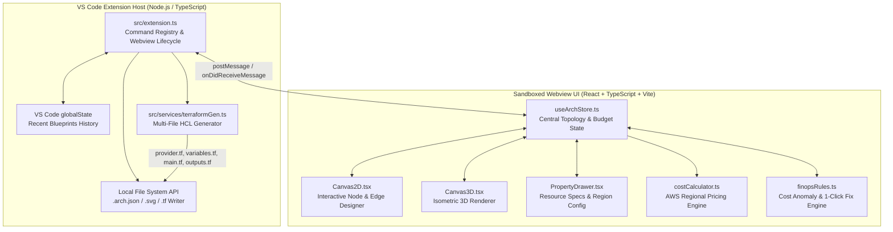

# AWS Arch Studio — 2D/3D Cloud Architecture Designer, FinOps Optimizer & Terraform Generator


**AWS Arch Studio** is a free, open-source Visual Studio Code extension that brings Cloudcraft-style 2D/3D AWS infrastructure modeling, real-time monthly cost estimation, automated FinOps savings recommendations, and multi-file Terraform Infrastructure-as-Code (IaC) generation directly inside your editor.

---

## Key Features

- **2D Drag-and-Drop Architecture Canvas:** Design AWS topologies with Regions, Availability Zones, VPCs, Subnets, Security Groups, EC2, RDS, S3, ALB/NLB, CloudFront, WAF, Route 53, KMS, Secrets Manager, and API Gateway.
- **Interactive 2D-to-3D Isometric View:** Switch between flat 2D schematic mode and real-time 3D isometric visualization with directional traffic animations.
- **Real-Time AWS Cost Calculator:** Computes per-resource and total monthly USD estimates across AWS regions (`ap-south-1`, `us-east-1`, `eu-west-1`, etc.) against a configurable monthly budget threshold.
- **FinOps Optimization Engine (1-Click Fixes):** Automatically detects cost inefficiencies (e.g., `gp2` to `gp3` EBS upgrades, Graviton `t4g` instance right-sizing, non-prod off-hours scheduling) and applies optimizations directly to the canvas and generated Terraform code.
- **Multi-File Terraform Generator:** Exports production-structured HCL files (`provider.tf`, `variables.tf`, `main.tf`, `outputs.tf`) with proper resource dependencies, dynamic AMI/AZ data lookups, and security group bindings.
- **Blueprint Persistence & Vector Export:** Save and reload architectures as `.arch.json` blueprints with recent-file history, or export crisp `.svg` vector diagrams for documentation.

---

## System Architecture



### Dual-Process Communication Flow
1. **Extension Host (`src/extension.ts`):** Runs in Node.js with full access to the VS Code API (`createWebviewPanel`, `showSaveDialog`, `showOpenDialog`, `globalState`, and local `fs` operations).
2. **Webview UI (`webview-ui/`):** Runs a bundled React + TypeScript application inside a secure VS Code Webview iframe, communicating bidirectionally with the Extension Host via typed JSON messages (`saveArchitecture`, `openArchitectureDialog`, `exportTerraform`, `exportDiagramSvg`).

---

## Project Folder Structure

```text
aws-arch-studio/
├── .vscode/
│   └── launch.json                 # Extension Development Host (F5) debug config
├── docs/
│   └── guide.html                  # Offline HTML architecture & build guide
├── src/
│   ├── data/
│   │   └── aws-pricing.json        # Regional AWS service unit pricing dataset
│   ├── panel/
│   │   └── ArchStudioPanel.ts      # Webview panel helper utilities
│   ├── services/
│   │   ├── pricingService.ts       # Backend pricing lookup helpers
│   │   └── terraformGen.ts         # HCL generator (provider, variables, main, outputs)
│   └── extension.ts                # Extension entry point, command & IPC handlers
├── webview-ui/
│   ├── src/
│   │   ├── components/
│   │   │   ├── BudgetHeader.tsx    # Top toolbar: Budget gauge, 2D/3D toggle, Save/Open/Export
│   │   │   ├── Canvas2D.tsx        # 2D interactive topology canvas & edge routing
│   │   │   ├── Canvas3D.tsx        # 3D isometric architecture canvas
│   │   │   ├── PropertyDrawer.tsx  # Right-hand resource inspector & FinOps cards
│   │   │   └── ServicePalette.tsx  # Left-hand searchable AWS component library
│   │   ├── engines/
│   │   │   ├── costCalculator.ts   # Real-time monthly cost calculation engine
│   │   │   └── finopsRules.ts      # FinOps rule evaluator & 1-click patch generator
│   │   ├── store/
│   │   │   └── useArchStore.ts     # Reactive state management for nodes, edges & budget
│   │   ├── App.tsx                 # Main layout & VS Code postMessage bridge
│   │   └── main.tsx                # React DOM entry point
│   ├── index.html
│   ├── package.json
│   └── vite.config.ts              # Single-bundle production Vite build config
├── .gitignore
├── .vscodeignore                   # Excludes node_modules & raw TypeScript from .vsix
├── LICENSE                         # MIT License
├── package.json                    # Extension manifest, commands & build scripts
├── README.md
└── tsconfig.json                   # TypeScript compiler config for Extension Host
```

---

## End-to-End Build Process (From Scratch to Packaging)

### Phase 1: Extension Host & Webview Scaffolding
1. Initialized the VS Code extension manifest (`package.json`) registering `awsArchStudio.open` and `aws-arch-studio.open` commands under the Command Palette (`AWS Arch Studio: Open Architecture Designer`).
2. Configured `esbuild` (`npm run compile`) to bundle `src/extension.ts` into a fast CommonJS entry point (`dist/extension.js`).
3. Scaffolded `webview-ui/` with **React + TypeScript + Vite** (`npm run build`) to compile the interactive UI into `webview-ui/dist/`.

### Phase 2: 2D/3D Canvas & State Architecture
1. Built `useArchStore.ts` to manage AWS service nodes, network connections (edges), target AWS region, and monthly budget limits.
2. Created `ServicePalette.tsx` for categorized AWS service drag-and-drop and `Canvas2D.tsx` for container nesting (Region -> AZ -> VPC -> Subnet -> Compute/Database) and link routing.
3. Implemented `Canvas3D.tsx` to project the exact same topology state into an isometric 3D diagram without duplicating state.

### Phase 3: Real-Time Cost Estimation & FinOps Engine
1. Created `costCalculator.ts` backed by regional AWS pricing data to calculate live monthly spend per component and highlight budget overruns in `BudgetHeader.tsx`.
2. Built `finopsRules.ts` to scan active nodes for storage (`gp2` -> `gp3`), compute family (`m5`/`t3` -> Graviton `t4g`), and scheduling optimizations, applying fixes in one click.

### Phase 4: Multi-File Terraform IaC Code Generation
1. Built `src/services/terraformGen.ts` to translate visual nodes and edges into four modular Terraform files:
   - `provider.tf` — Terraform block & AWS provider configured with the selected canvas region.
   - `variables.tf` — Input variables for region, VPC CIDR (`10.0.0.0/16`), and environment tags.
   - `main.tf` — Dynamic `aws_availability_zones` & `aws_ami` data sources, `aws_vpc`, `aws_subnet`, `aws_security_group`, `aws_instance`, RDS, S3, and load balancer resources.
   - `outputs.tf` — Exported VPC ID, Subnet IDs, and instance endpoints.
2. Integrated VS Code native folder picker (`showOpenDialog`) so generated `.tf` files save directly to disk and open side-by-side (`ViewColumn.Beside`) in the editor.

### Phase 5: `.vsix` Packaging & Local Installation
1. Configured `.vscodeignore` to exclude `node_modules/`, raw `.ts/.tsx` sources, and map files—reducing the packaged `.vsix` bundle from **282 MB** down to **481 KB (19 files)**.
2. Compiled both targets and packaged the distributable extension:
   ```powershell
   npm run compile
   npm run build
   npx @vscode/vsce package --allow-missing-repository
   ```
3. Installed the packaged extension directly into VS Code:
   ```powershell
   code --install-extension aws-arch-studio-0.1.0.vsix
   ```

---

## Installation & Quick Start

### Option A: Install from `.vsix` Package (Recommended)
1. Download `aws-arch-studio-0.1.0.vsix` from the [GitHub Releases](https://github.com/hari930531/aws-arch-studio/releases) page.
2. Open VS Code -> Press `Ctrl + Shift + X` -> Click `...` (top-right of Extensions view) -> **Install from VSIX...** -> Select `aws-arch-studio-0.1.0.vsix`.
3. Press `Ctrl + Shift + P`, type **`AWS Arch Studio: Open Architecture Designer`**, and press `Enter`.

### Option B: Run from Source
```powershell
git clone https://github.com/hari930531/aws-arch-studio.git
cd aws-arch-studio
npm install
cd webview-ui && npm install && cd ..
npm run compile && npm run build
```
Press **`F5`** in VS Code to launch the **Extension Development Host**.

---

## Usage Workflow
1. **Design:** Drag AWS components (VPC, Subnet, Security Group, EC2, RDS, ALB, CloudFront, WAF) from the left palette onto the 2D canvas and connect them using **Link** mode.
2. **Inspect & Optimize:** Click any resource to configure instance types, storage size, or region in the right drawer, and click **Apply Fix** on FinOps recommendations to lower monthly costs.
3. **Visualize in 3D:** Toggle **3D View** in the top bar to inspect your architecture in isometric 3D.
4. **Export Infrastructure:** Click **Generate Terraform** to write `provider.tf`, `variables.tf`, `main.tf`, and `outputs.tf` into your workspace, or **Save** your blueprint as `.arch.json`.

---

## Author & License
- **Author:** Hari M ([@hari930531](https://github.com/hari930531))
- **License:** Distributed under the [MIT License](LICENSE).